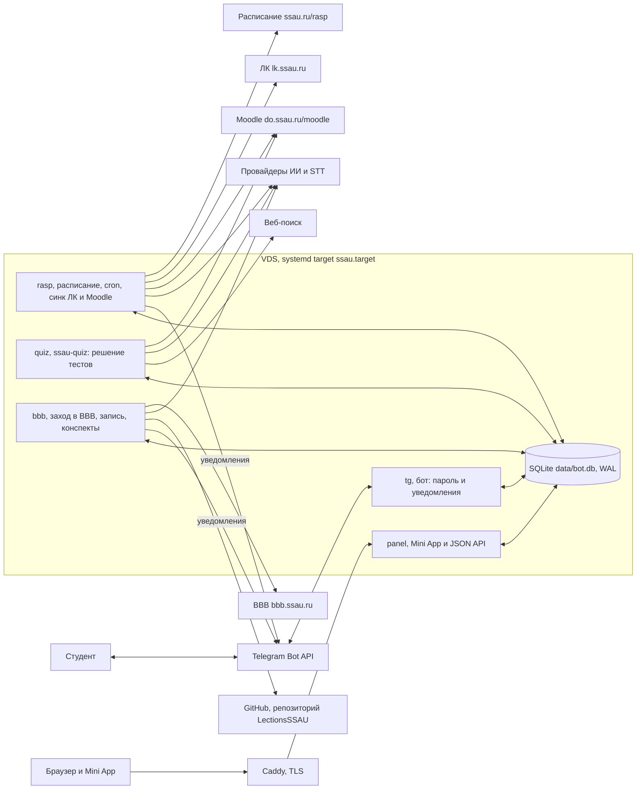
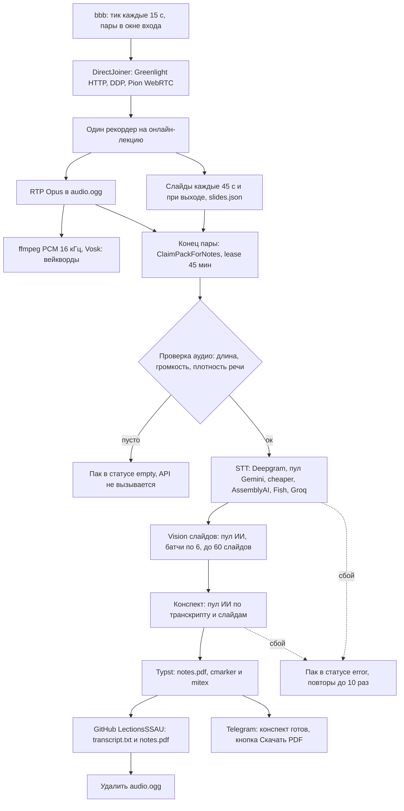
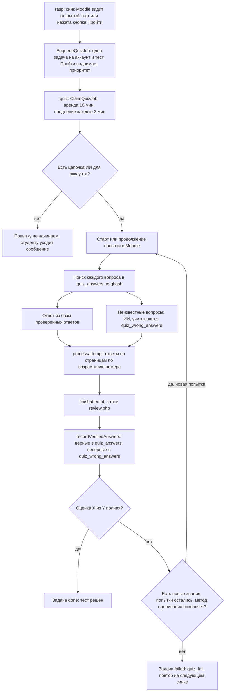

# SSAU Lecture Bot

[](go.mod)
[](docs/ARCHITECTURE.md)
[](https://core.telegram.org/bots/api)
[](deploy/ssau.target)
[](https://typst.app)
[](https://github.com/r4r1ty-tech/AIstudydevb2bsaas/actions/workflows/deploy.yml)
[](https://github.com/r4r1ty-tech/AIstudydevb2bsaas/actions/workflows/codeql.yml)
[](.golangci.yml)

Бот и веб-панель для студентов Самарского университета (SSAU). Он сам смотрит расписание и Moodle, заходит на онлайн-лекции в BBB без браузера, записывает их, расшифровывает речь и собирает конспекты в PDF. Открытые тесты Moodle решаются через ИИ, а верные ответы сохраняются в общую базу. Всё работает на одном VDS: пять процессов на Go, общая SQLite и systemd.

## Содержание

- [Возможности](#возможности)
- [Стек](#стек)
- [Архитектура](#архитектура)
- [Структура репозитория](#структура-репозитория)
- [Быстрый старт](#быстрый-старт)
- [Конфигурация](#конфигурация)
- [Тесты и качество](#тесты-и-качество)
- [Деплой](#деплой)
- [Эксплуатация](#эксплуатация)
- [Документация](#документация)
- [Важно](#важно)

## Возможности

- 📅 **Расписание.** Парсер `ssau.ru/rasp` или личного кабинета (`lk.ssau.ru`), подгруппы, индивидуальные пары (ИОТ), онлайн-ссылки BBB. Каждый прогон сравнивается с предыдущим (diff), изменения попадают в журнал.
- 🎥 **Заход в BBB без браузера.** Greenlight HTTP, Meteor DDP и Pion WebRTC в режиме «только слушать». Лобби, переподключение, выход из комнаты в конце пары. Сессии работают через SOCKS5-прокси, если он задан.
- 🎙 **Запись и слайды.** RTP Opus пишется в `.ogg` напрямую, без PulseAudio. Слайды сохраняются во время лекции вместе с текстовым слоем и таймкодами. На одну онлайн-лекцию записывает один участник, даже если подгрупп несколько.
- 🗣 **Расшифровка речи с откатом.** Deepgram `nova-3`, затем бесплатный пул Gemini, затем cheaper (`whisper-large-v3-turbo`, ключ администратора), затем платные AssemblyAI, Fish и Groq.
- 📝 **Конспекты и PDF.** LLM делает конспект по транскрипту и слайдам, vision описывает слайды. PDF собирает Typst с пакетами `cmarker` и `mitex`, которые вшиты в бинарник. Транскрипт и PDF публикуются в GitHub-репозиторий `LectionsSSAU`.
- 🔔 **Вейкворды.** Vosk распознаёт речь на паре. Если прозвучало слово из профиля студента, приходит уведомление. Совпадение также сразу запускает проверку открывшихся тестов.
- 🧩 **Решатель тестов Moodle (`ssau-quiz`).** Тесты ставятся в очередь в SQLite, задача захватывается с арендой. Ответы берутся из базы проверенных ответов, для остальных вопросов вызывается ИИ. Ответы сверяются с `review.php`, верные сохраняются, при неполной оценке возможен автоповтор.
- 🔑 **Личные ключи ИИ и общий пул.** Каждый может подключить свой ключ Gemini или OpenCode. Ключи шифруются AES-GCM, владелец может поделиться ключом с общим пулом. Расход за сутки и кулдауны после HTTP 429 ведутся по каждому провайдеру.
- 🌐 **Веб-панель (Mini App).** Пары и решения «заходить / не заходить», неделя, дедлайны Moodle с кнопкой «Пройти», конспекты, аккаунт универа, выбор модели ИИ. Раздел «Служебное» доступен только администратору.
- 🤖 **Telegram-бот.** Выдаёт личный пароль в панель (действует час) и присылает уведомления. Отвечает только людям из вайтлиста.

## Стек

| Область | Технологии |
| --- | --- |
| Язык и сборка | Go 1.26 (`go.mod`, toolchain go1.26.11). Бинарники `linux/amd64`, `CGO_ENABLED=0`, `-trimpath` |
| База данных | SQLite через `modernc.org/sqlite` (WAL, `busy_timeout`, один `.env`) |
| Telegram | `gotgbot/v2` для бота. Уведомления шлются напрямую через Bot API (`internal/notify`) |
| Расписание и HTML | `net/http`, `goquery` |
| BBB | собственный клиент: Greenlight HTTP, Meteor DDP, `pion/webrtc/v4`, `pion/rtp` |
| Сеть и прокси | `golang.org/x/net/proxy` (SOCKS5), локальные реле на сессию (`internal/proxyrelay`) |
| Аудио и вейкворды | `ffmpeg` (PCM 16 кГц), Opus-дамп в Ogg, Vosk через Python-скрипт `deploy/wake.py` |
| ИИ и STT | OpenAI-совместимый `chat/completions`: Gemini (Google AI Studio), OpenCode Zen, cheaper; STT: Deepgram, AssemblyAI, Fish Audio, Groq |
| Веб-поиск решателя | Tavily, Exa, SearXNG, DuckDuckGo lite (цепочка с откатом) |
| PDF | Typst 0.15.1 (sha256 проверяет CI), `cmarker` 0.1.10 и `mitex` 0.2.7 через `go:embed` |
| Панель | `net/http`, статика через `go:embed`, ванильные JS и CSS, hash-роутинг |
| Шифрование | AES-GCM для паролей и сессий (`internal/vault`), HMAC для часовых паролей панели |
| Деплой | GitHub Actions, `scp` и `ssh`, systemd (`ssau.target`), Caddy с Let's Encrypt, опционально cloudflared |
| Качество | `go test`, `go vet`, golangci-lint v2.15.0 (gosec, bodyclose, noctx, prealloc, perfsprint), govulncheck v1.9.0, CodeQL |

## Архитектура

### Процессы

Пять независимых процессов, общая SQLite (WAL) и один `.env`. Общая библиотека лежит в `internal/*` и отдельно не запускается.

| Процесс | Unit | Роль | Порт |
| --- | --- | --- | --- |
| `tg` | `ssau-tg.service` | Telegram-бот: пароль в панель, напоминания о сроках Moodle, выдача PDF | нет |
| `rasp` | `ssau-rasp.service` | Парсер расписания (cron), синк ЛК и Moodle, постановка тестов в очередь | нет |
| `quiz` | `ssau-quiz.service` | Решение тестов Moodle из очереди `quiz_jobs` | нет |
| `panel` | `ssau-panel.service` | Mini App и JSON API. Единственный процесс с входящим HTTP | да, за Caddy |
| `bbb` | `ssau-bbb.service` | Заход в BBB, запись, слайды, вейкворды, конспекты | нет |

`ssau.target` поднимает все пять процессов, кроме туннеля `ssau-tunnel` (он включается только без `PANEL_TUNNEL=0`). На проде HTTPS для панели даёт Caddy, а процесс `panel` слушает только loopback.

### Схема



### Конвейер лекции

От тика воркера до PDF в Telegram. Этапы после пары собираются из кэша, поэтому при обрыве работа продолжается с места остановки.



Цепочка STT идёт по порядку, и на каждом шаге можно откатиться к следующему провайдеру. Пул Gemini режет запись на куски по 10 минут. Кусок, который не расшифровался, уходит в Deepgram и cheaper. Конспект и vision работают только на бесплатном пуле: cheaper в них не участвует.

### Решение тестов Moodle

Синк `rasp` только находит открытые тесты и ставит задачи в очередь. Решает их `ssau-quiz`.



Задача, которую держит умерший процесс, возвращается в очередь, когда истекает аренда. Попытка Moodle при этом продолжается той же. Журнал решателя пишется в `<папка базы>/quiz-debug` и доступен в панели администратору.

### Данные

Основные таблицы SQLite (полная схема в [docs/ARCHITECTURE.md](docs/ARCHITECTURE.md)):

| Таблица | Что хранит |
| --- | --- |
| `users` | профиль студента для BBB, подгруппа, вкл/выкл, вейкворды |
| `lessons`, `join_intents` | пары и решение «заходить / не заходить» (молчание = заходить) |
| `presence`, `events` | текущее состояние в BBB и лента событий |
| `lecture_packs`, `pack_lessons` | запись, слайды и конспект одной лекции; алиасы для подгрупп |
| `accounts`, `moodle_items` | аккаунты ЛК и Moodle (пароли и сессии зашифрованы), задания и сроки |
| `llm_keys`, `llm_usage` | личные ключи ИИ и учёт расхода по дням |
| `quiz_jobs`, `quiz_answers`, `quiz_wrong_answers` | очередь тестов, база проверенных ответов, отрицательная память |
| `web_sessions`, `settings` | сессии панели и служебные настройки |

## Структура репозитория

```
.
├── cmd/
│   ├── tg/            бот: пароль в панель и уведомления
│   ├── rasp/          парсер расписания, cron, синк ЛК и Moodle
│   ├── quiz/          сервис ssau-quiz: решение тестов из очереди
│   ├── panel/         веб-панель: Mini App и JSON API
│   ├── bbb/           воркер BBB: заход, запись, слайды, конспекты
│   ├── mcp/           MCP-сервер Moodle: stdio и Streamable HTTP
│   ├── mcpeval/       клиент MCP: read-only evals и JSON-отчёт
│   ├── ssau-keys/     утилита: смена ключа ИИ и токена бота на проде
│   └── unicheck/      разовая проверка клиентов ЛК и Moodle
├── internal/
│   ├── access/        админ, мост ключей ИИ, цепочки провайдеров, ФИО из ЛК
│   ├── app/           общий старт процесса: .env, логи, sqlite, часовой пояс
│   ├── archive/       имена файлов и путей записей, слайдов и конспектов
│   ├── bbb/           воркер захода, DirectJoiner, запись, слайды, лобби
│   ├── capture/       RTP Opus в .ogg и декодирование PCM через ffmpeg
│   ├── config/        загрузка .env, вайтлист, значения по умолчанию
│   ├── llm/           провайдеры ИИ, KeyPool (429-кулдаун, семафор на ключ)
│   ├── logx/          уровни логов, stderr и файл, ротация
│   ├── lk/            клиент lk.ssau.ru: вход, расписание, ФИО
│   ├── model/         доменные типы: User, Lesson, JoinIntent, LecturePack
│   ├── moodle/        клиент Moodle: вход, курсы, сроки, попытки, review
│   ├── notes/         STT, vision, конспект, PDF через Typst
│   ├── notify/        отправка в Telegram без процесса tg
│   ├── panelpass/     часовые пароли входа в панель
│   ├── proxyrelay/    локальные SOCKS5-реле на каждую сессию
│   ├── publish/       выгрузка транскриптов и PDF в GitHub
│   ├── quizlog/       журнал решателя тестов для панели
│   ├── rasp/          Fetch, Parse, Diff, Refresh, cron расписания
│   ├── store/         sqlite: схема, миграции, запросы
│   ├── tg/            Telegram-бот
│   ├── tgtest/        фейковый Telegram Bot API для тестов
│   ├── uni/           синк ЛК и Moodle, решатель тестов, очередь quiz
│   ├── vault/         AES-GCM для паролей и сессий
│   ├── wake/          вейкворды: распознавание, поиск слов и их форм
│   ├── webapp/        Mini App: статика, JSON API, сессии, rate-limit
│   ├── websearch/     веб-поиск для решателя
│   └── websess/       HTTP-клиент «как браузер» с куками
├── deploy/            systemd-юниты, ssau.target, remote.sh, tunnel.sh, wake.py, reset-data.sh
├── docs/              ARCHITECTURE, OPERATIONS, MOODLE_QUIZ, MCP, TESTING
├── evals/             read-only задачи Moodle для cmd/mcpeval
├── .github/workflows/ deploy.yml, codeql.yml, reset-data.yml
├── env.example        шаблон .env со всеми переменными
├── PLAN.md            замысел и история решений
└── go.mod
```

## Быстрый старт

Нужны Go 1.26 (toolchain подтянется сам). Для PDF понадобится `typst` в `PATH` или путь в `TYPST_BIN`. Для звука BBB и вейквордов нужны `ffmpeg`, Python 3 с пакетом `vosk` и модель Vosk. Для локального запуска без этого всего хватает токена бота.

```bash
cp env.example .env      # вписать TELEGRAM_BOT_TOKEN, PANEL_PASSWORD, при желании GEMINI_API_KEYS
go build -o bin/tg ./cmd/tg
go build -o bin/rasp ./cmd/rasp
go build -o bin/quiz ./cmd/quiz
go build -o bin/panel ./cmd/panel
go build -o bin/bbb ./cmd/bbb
```

Запуск процессов по отдельности:

```bash
go run ./cmd/rasp        # парсер берёт публичную страницу расписания без ключей
BBB_DRY_RUN=1 go run ./cmd/bbb   # заход в BBB заменяется заглушкой DryJoiner
```

Панель можно открыть без базы и бота, на тестовых данных в памяти:

```bash
PANEL_DEMO=1 LISTEN_ADDR=127.0.0.1:18080 go run ./cmd/panel
# затем открыть http://127.0.0.1:18080
```

Демо санирует все ключи, токены и пути к базе, поэтому реальные данные из `.env` в нём не используются.

## Конфигурация

Один `.env` на все процессы, его читает `internal/config`. Реальные переменные окружения имеют приоритет над файлом. Полный шаблон с комментариями лежит в [env.example](env.example), здесь только самое важное:

| Переменная | Назначение |
| --- | --- |
| `TELEGRAM_BOT_TOKEN` | токен бота, нужен `tg` и `panel` |
| `ADMIN_TELEGRAM_ID` | Telegram id администратора (обязательно, без дефолта): «Служебное», cheaper и админские уведомления |
| `WHITELIST` | Telegram id через запятую или пробел (вайтлист бота и панели); админ добавляется сам |
| `PANEL_PASSWORD` | общий пароль панели для входа администратором |
| `PANEL_ALLOW_IPS`, `PANEL_TRUST_PROXY` | фильтр IP и доверие `X-Forwarded-For` от Caddy на loopback |
| `LISTEN_ADDR`, `PANEL_DEMO` | адрес панели, демо-режим |
| `DATABASE_PATH`, `SECRET_KEY`, `SECRET_KEY_FILE` | база, ключ шифрования паролей и сессий (создаётся сам при первом запуске) |
| `TZ`, `GROUP_ID`, `GROUP_CODE` | часовой пояс расписания (дефолт `Europe/Samara`) и группа-якорь (обязательно, без дефолта) |
| `BBB_DRY_RUN`, `LECTURE_PAUSE`, `PROXY_FILE` | заглушка BBB, заморозка тяжёлых процессов на время пары, SOCKS5-список |
| `GEMINI_API_KEYS`, `OPENCODE_API_KEYS` | общие бесплатные пулы ИИ |
| `LLM_API_KEY`, `LLM_API_URL`, `LLM_MODEL` | ключ админа (cheaper): запасной ИИ и STT |
| `ROUTERHUB_API_KEY`, `ROUTERHUB_API_URL`, `ROUTERHUB_MODEL` | ключ админа RouterHub: платный ИИ для консенсуса тестов (по умолчанию `glm-5.3`) |
| `DEEPGRAM_API_KEY`, `DEEPGRAM_MODEL`, `CHEAPER_STT_MODEL` | первый провайдер STT и модели расшифровки |
| `ASSEMBLYAI_API_KEY`, `FISH_STUDIO_API_KEY`, `GROQ_API_KEY` | платные запасные провайдеры STT |
| `TAVILY_API_KEY`, `EXA_API_KEY`, `SEARXNG_URL` | веб-поиск решателя тестов |
| `QUIZ_MODE`, `QUIZ_MAX_PARALLEL`, `QUIZ_MOODLE_RPS`, `MOODLE_WORKERS` | очередь тестов: `service` или `inline`, параллельность, частота обращений к Moodle |
| `QUIZ_CONSENSUS`, `QUIZ_CONSENSUS_MAX`, `QUIZ_CONSENSUS_SHARE` | консенсус тестов: минимум разных API-ключей на вопрос (3), предел перебора (9) и нужная доля голосов (66%) |
| `QUIZ_CONFIDENCE_MIN` | минимальная уверенность модели (0.5), чтобы принять ответ без единогласия |
| `LLM_REASONING_EFFORT`, `LLM_TEMPERATURE`, `LLM_MAX_TOKENS`, `LLM_JSON_MODE` | параметры генерации: глубина размышлений (`max` по умолчанию), температура, лимит токенов, JSON-режим |
| `TYPST_BIN`, `VOSK_MODEL`, `VOSK_SCRIPT` | бинарник Typst, модель и скрипт вейквордов |
| `GITHUB_TOKEN`, `GITHUB_OWNER`, `GITHUB_REPO`, `GITHUB_BRANCH` | выгрузка конспектов в GitHub (без токена выгрузка выключена) |
| `LOG_LEVEL`, `LOG_FILE`, `LOG_DIR` | уровень технических логов и файлы логов |

<details>
<summary>Ещё про настройку</summary>

- **Очередь тестов.** `QUIZ_MODE=service` (по умолчанию в проде) ставит тесты в очередь, решает `ssau-quiz`. `QUIZ_MODE=inline` решает тесты в процессе `rasp`, это удобно для разработки.
- **Консенсус тестов.** По умолчанию каждый вопрос решают минимум три модели на **разных** API-ключах из общего пула (ключи `.env` + личные ключи из БД + ключ админа). Побеждает ответ, набравший не меньше двух третей голосов (`QUIZ_CONSENSUS_SHARE=66`) и строго больше остальных; при разбросе добавляется следующий ключ. Ответ без единогласия принимается, только если модели оценили его уверенность не ниже `QUIZ_CONFIDENCE_MIN` (0.5). `QUIZ_CONSENSUS=0` выключает режим.
- **Размышления моделей.** Все запросы идут с `reasoning_effort` по максимуму модели (`LLM_REASONING_EFFORT=max`: `xhigh` у Gemini 4 hydrogen/neon, `high` у остальных). В тестах глубина снижается до `medium` при бюджете страницы меньше 2 минут и до `low` в быстром режиме, иначе ответы не успеют до таймера Moodle. Если API не знает поле, запрос повторяется без него.
- **Тайминги тестов.** Из лимита Moodle вычитается 75 с на сдачу. Для 3-минутного теста остаётся ~1м45 — консенсус идёт на быстрых моделях (flash-lite/flash), 4-й ключ не добирается; при остатке <45 с — одна быстрая цепочка. Для 5-минутного (~3м45) — те же 3 быстрых ключа; длинные тесты могут брать сильные модели. При последовательной навигации на страницу даётся не больше 90 с, иначе следующая не успеет.
- **Ключи ИИ.** Ключи из `.env` подписываются именем владельца, например `Имя:ключ`, и подпись видна в панели. Личные ключи студентов хранятся в базе в зашифрованном виде.
- **Вход в панель.** Студент получает в боте часовой пароль, HMAC от ключа хранилища. Сессия выдаётся на 30 дней с продлением, потолок 90 дней. Пять неудачных попыток с одного IP за 10 минут блокируют вход на 5 минут.
- **Проверка учётных записей.** Аккаунт ЛК или Moodle, который сайт не принял, получает статус `bad_login` и не дёргается, пока пароль не обновят.
- **BBB и 403.** Заходы на один хост BBB ограничены двумя одновременными рукопожатиями, старты разнесены на ~1.5 с; после `403`/`429` хост получает общий cooldown (15 с → 30 с → до 2 мин), чтобы весь поток не долбил сервер. В логе `ddp handshake` теперь виден точный HTTP-статус, `Retry-After` и заголовки ответа.
- **Логи.** `LOG_DEBUG=1` по умолчанию пишет подробный лог каждого процесса в `LOG_DIR`. Снимки страниц и ответов ИИ лежат в `LOG_DIR/dumps` и имеют общий потолок размера.

</details>

## Тесты и качество

```bash
go test ./...                    # все тесты
CGO_ENABLED=0 go test ./...      # так же, как в CI
go test ./... -cover             # покрытие по пакетам
go test ./internal/bbb/ -race    # конкурентный воркер
go vet ./...
golangci-lint run                # конфиг в .golangci.yml
```

Тесты не требуют сети. Внешние API подменяются `httptest`, база создаётся во временной папке, живой BBB заменяется `DryJoiner`. Протокол BBB, WebRTC и Opus проверяется на локальных mock-серверах:

```bash
go test -v -race ./internal/capture/... ./internal/bbb/... -run 'TestOpus|TestDirect'
```

Ручной прогон всех функций на живых сайтах описан в [docs/TESTING.md](docs/TESTING.md). Для него нужна тестовая комната BBB. Проверка клиентов ЛК и Moodle без бота и без сохранения данных:

```bash
UNI_LOGIN=... UNI_PASSWORD=... go run ./cmd/unicheck
```

## Деплой

Деплой идёт через GitHub Actions (`.github/workflows/deploy.yml`, workflow «Test and deploy VDS»):

1. **test.** Устанавливается `typst` v0.15.1 с проверкой sha256, затем `CGO_ENABLED=0 go test ./...`.
2. **lint.** golangci-lint блокирует только новые замечания относительно `HEAD~1`. Потом `govulncheck` по зависимостям и вызовам.
3. **deploy.** Выполняется при пуше в `main` или ручном запуске. Собираются пять бинарников `linux/amd64`, `typst` кладётся в артефакты, файлы копируются по `scp` в `/tmp/ssau-deploy`, затем запускается `deploy/remote.sh`.

`remote.sh` ставит бинарники и юниты в `/opt/ssau-bot` и `/etc/systemd/system`, устанавливает `ffmpeg`, `python3` и `typst` в `/usr/local/bin`, создаёт swap и модель Vosk. Обновляет `LLM_*` и `GITHUB_*` в `.env` и перезапускает `tg`, `rasp` и `panel`. `quiz` перезапускается только если изменился бинарник (сравнивается sha256). `bbb` перезапускается только если был запущен. При первом деплое `.env` на сервере нужно положить вручную: без него сервисы не стартуют.

Секреты репозитория: `VDS_SSH_KEY` и `VDS_HOST` (обязательны, без дефолта), `VDS_USER`, `VDS_PORT`, `LLM_API_KEY`, `LLM_API_URL`, `LLM_MODEL` (или `DEEPSEEK_API_KEY`), `ROUTERHUB_API_KEY` (ключ админа RouterHub), при необходимости `ROUTERHUB_API_URL` и `ROUTERHUB_MODEL`, `LECTURES_TOKEN`. Деплой с другой ветки: `gh workflow run deploy.yml --ref <ветка>`.

Панель работает за Caddy. Блок для Caddyfile, где `panel.example.com` — ваш домен:

```caddy
panel.example.com {
    reverse_proxy 127.0.0.1:8080
}
```

В `.env` при этом задаются `LISTEN_ADDR=127.0.0.1:8080`, `PANEL_TRUST_PROXY=1`, `PANEL_TUNNEL=0` и `PANEL_ALLOW_IPS` со своими адресами. Без своего домена можно включить запасной туннель cloudflared (`ssau-tunnel`), он пишет свежий адрес в файл, а бот сам подхватывает его.

## Эксплуатация

Подробные рецепты диагностики, SQL по очереди тестов и разбор логов собраны в [docs/OPERATIONS.md](docs/OPERATIONS.md).

```bash
systemctl status ssau.target ssau-bbb.service
journalctl -u ssau-bbb -f                     # живой хвост одного процесса
journalctl -u ssau-bbb -p warning -f          # только предупреждения и ошибки
systemctl restart ssau-bbb.service
systemctl stop ssau.target                    # остановить всё
```

<details>
<summary>Утилиты и обслуживание</summary>

- **Смена ключей на проде.** `go run ./cmd/ssau-keys` спрашивает ключ ИИ администратора и токен бота, проверяет их, пишет в `.env` на сервере и в секреты GitHub, после чего перезапускает сервисы. Иначе CI-деплой вернул бы старый ключ.
- **Разовая проверка аккаунтов.** `go run ./cmd/unicheck` берёт логин и пароль из `UNI_LOGIN` и `UNI_PASSWORD`, печатает, что удалось достать (пары, ссылки BBB, Moodle), и ничего не сохраняет.
- **Сброс данных.** Workflow «Reset VDS data» (`.github/workflows/reset-data.yml`, ручной запуск) останавливает сервисы, удаляет базу и записи лекций, `.env` и бинарники не трогает. Данные не восстанавливаются, запускать только осознанно.
- **Дедупликация паков.** При открытии базы миграция объединяет дубликаты лекций по `meeting_key`.
- **Заморозка на время пары.** `LECTURE_PAUSE=1` приостанавливает тяжёлые сторонние процессы, чтобы не мешать записи.

</details>

<details>
<summary>Очередь тестов: быстрая проверка</summary>

```bash
DB=/opt/ssau-bot/data/bot.db
sqlite3 -header -column "$DB" "SELECT status, COUNT(*) AS n FROM quiz_jobs GROUP BY status;"
sqlite3 -header -column "$DB" "SELECT id, telegram_id, cmid, last_error, updated_at FROM quiz_jobs WHERE status='failed' ORDER BY updated_at DESC LIMIT 20;"
```

Остановка `ssau-quiz` не теряет тесты: незавершённые задачи возвращаются в `queued`. Если сервис не запущен, тесты копятся в очереди.

</details>

## Документация

- [PLAN.md](PLAN.md): замысел, решения, история этапов
- [docs/ARCHITECTURE.md](docs/ARCHITECTURE.md): процессы, пакеты, схема данных, ключевые сценарии, API панели
- [docs/OPERATIONS.md](docs/OPERATIONS.md): конфиг, вход в панель, ИИ и ключи, STT, логи, systemd, деплой, диагностика
- [docs/MOODLE_QUIZ.md](docs/MOODLE_QUIZ.md): жизненный цикл попытки в `mod/quiz`, типы вопросов, база проверенных ответов
- [docs/MCP.md](docs/MCP.md): MCP-сервер Moodle: инструменты, ресурсы, промпты, stdio/HTTP, безопасность и evals
- [docs/TESTING.md](docs/TESTING.md): runbook ручной проверки всех функций
- [env.example](env.example): все переменные окружения

## Важно

- Посещение лекции гостем и запись пары лежат в сером поле правил университета и BBB. Используйте на свой риск.
- Репозиторий публичный. Токены, записи пар, базу и `.env` в него не класть. Папки `data/` и `recordings/`, файлы `.env` и `*.log` уже в `.gitignore`.
- Бот не работает с произвольными пользователями: только вайтлист и администратор. Всё остальное делается в панели.
